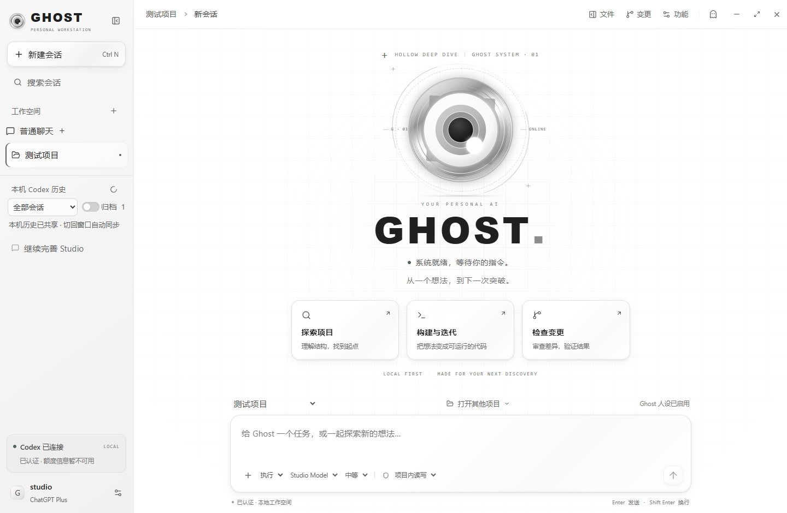

# Ghost Studio

本地优先的 Windows Codex 桌面工作台。当前版本 **0.2.0**，采用 C3 白色玻璃界面：白色主背景、浅灰网格与轨道、银灰大眼睛和透明玻璃控件。工作台、桌宠、任务栏及托盘图标使用同一套视觉。默认字号为 **18**；默认人设采用 Fairy-DSH 的公开预设风格，助手名称保持 **Ghost**。



[文档导航](docs/README.md) · [开发与打包](docs/DEVELOPMENT.md) · [功能边界](docs/CODEX-PARITY.md) · [验证记录](docs/VERIFICATION.md) · [正式发布内容](RELEASE-CONTENTS.md)

## 启动与使用

本地已有构建时，双击项目目录中的 `启动Ghost.cmd`，或运行 `dist/win-unpacked/GhostStudio.exe`。安装程序为 `dist/Ghost Studio Setup 0.2.0.exe`。安装包自带运行环境；使用 AI 能力仍需安装并登录官方 Codex CLI。

仓库同时保存源码和正式构建，`dist/` 中的二进制通过 Git LFS 管理。克隆前安装 Git LFS，执行 `git lfs install`，克隆后执行 `git lfs pull` 获取实际程序文件；GitHub 页面上的源码 ZIP 可能只包含 LFS 指针。

1. 直接使用“普通聊天”；需要开发时，再打开本地项目目录。
2. 在左下角设置检查 Codex 连接；未自动发现时选择 `codex.exe`，按需通过 ChatGPT 登录。
3. 选择模型、执行或计划模式，输入消息或添加附件。Enter 发送，Shift+Enter 换行。
4. 右上角打开文件或变更面板；“功能”进入 Codex 功能中心。
5. 关闭主窗口或点击 Ghost 按钮会收起为桌宠，当前任务继续执行。从托盘菜单或桌宠电源按钮选择“退出”才会真正退出。

桌宠支持拖动、右键眼睛或点击对话按钮展开聊天，点击眼睛恢复工作台。任务状态、会话选择和已有会话草稿与主窗口共享。更新构建后，先从托盘退出旧实例，再重新启动。

## 当前能力

- 项目导航、普通聊天、本机 Codex 历史共享，支持分页、来源/归档筛选和恢复会话。
- 流式回复、工具记录、停止、执行中补充指令和原生队列，支持 Plan 模式、计划与用量展示。
- 图片、音频、文件及显式技能附件；命令、文件修改、额外权限、问题回答、MCP 与工具请求交互。
- Monaco 多文件编辑、显式保存、外部修改冲突检查；Git 状态与工作区/暂存区只读 Diff。
- 功能中心接入当前协议快照的 168 个可操作请求，包括会话管理、项目、Skills、MCP、插件和高级参数表单。
- 沙箱非交互终端与需要明确确认的主机交互 PTY。
- 可修改的人设、文字大小和动效设置；支持系统减少动效偏好。
- 透明桌宠、任务与回复摘要、位置保存、托盘和恢复工作台。

接口入口不等于完整官方交互，也不表示所有接口都已逐项实调。当前仍同时执行一个任务。完整状态见 [功能清单](docs/CODEX-PARITY.md) 和 [接口覆盖表](docs/CODEX-INTERFACES.md)。

## 数据与执行边界

应用元数据默认位于 `%APPDATA%/ghost-studio/`，包括 SQLite 设置、项目/会话引用和草稿；`GHOST_HOME` 可指定独立目录。凭据与会话正文由 Codex 管理，本应用不复制登录令牌。

本机共享范围取决于同一 `CODEX_HOME` 下 App Server 可枚举的持久会话，不会仅因相同账户自动接通 ChatGPT 云端或远程历史。查看历史只读，发送时才恢复线程并应用 Studio 设置。不要在多个客户端同时执行同一会话。

编辑器与文件接口限制在已打开项目，拒绝项目外路径、目录联接逃逸及内部目录。文本文件上限 2 MB，保存使用版本校验。模型执行另受 Codex 沙箱与审批约束；普通聊天默认只读。退出应用会中止任务，重启不会自动重发。

## 开发与验证

开发需要 Node.js 24+、npm 和 Git。源码开发命令：

```powershell
npm.cmd ci
npm.cmd run dev
```

常规检查及构建：

```powershell
npm.cmd run check
npm.cmd run build
npm.cmd run check:ui
npm.cmd run package:dir
npm.cmd run check:package
npm.cmd run check:icons
```

UI 验证与图标导出还需本机 Chrome；原生及图标检查需 Windows 桌面环境。这组检查使用模拟 IPC 或隔离数据，不发起真实模型任务。会消耗额度的 CLI/桌面检查单独列在 [开发文档](docs/DEVELOPMENT.md)。

`npm.cmd run package` 生成 NSIS 安装包，并更新 `dist/SHA256SUMS.txt`。当前没有发布者代码签名或自动更新。已记录验证的协议快照为 Codex `0.163.0-alpha.11.2`，更换 CLI 后应重新检查兼容性。

## 仓库结构

| 目录 | 内容 |
| --- | --- |
| `src/main/` | Electron、RPC、业务状态、文件边界与 SQLite |
| `src/preload/` | 类型化 IPC 桥接 |
| `src/renderer/` | React、C3 样式、Ghost、编辑器与终端 |
| `src/shared/` | 共享类型、能力描述与已保存协议快照 |
| `resources/` | 透明 PNG 和多尺寸 ICO |
| `tests/`、`scripts/` | 自动测试、离线 UI 检查、诊断和构建工具 |
| `docs/`、`licenses/` | 当前文档、历史记录、界面截图及许可 |
| `out/` | 临时编译结果，Git 忽略 |
| `dist/` | 正式安装包与解压式构建，通过 Git LFS 保存；SHA-256 清单为普通文本 |
| `output/`、`.ghost-dev/`、`.reference/` | 本地概念图/验证产物、隔离测试数据及参考导出，Git 忽略 |

本目录是 Ghost-codex 正式项目。既有旧安装包、依赖缓存、概念图和测试数据库保留在原开发工作目录，未移入本发布目录或应用包。

## 视觉来源

眼睛 SVG 与几何参数改编自 [Fairy-DSH](https://github.com/Chengzhibense/Fairy-DSH) 的固定提交 `d639887a386b0de6fef2e61c97dc268631854591`，包括本项目的银灰材质与环纹调整。署名、Apache-2.0 许可和 NOTICE 见 [第三方说明](THIRD_PARTY_NOTICES.md) 与 `licenses/`。Windows 图标直接从同一 SVG 导出。

默认人设改编自同一提交的 `.agent-presets/fairy/agent.cordis.yml` 公开 persona 配置，保留表达与行为核心并适配 Ghost 名称及 Studio 能力；未修改过的旧默认设置会一次性升级，自定义人设和关闭状态保留。详见 [默认设置更新](docs/CHANGES-DEFAULTS-RELEASE.md)。
